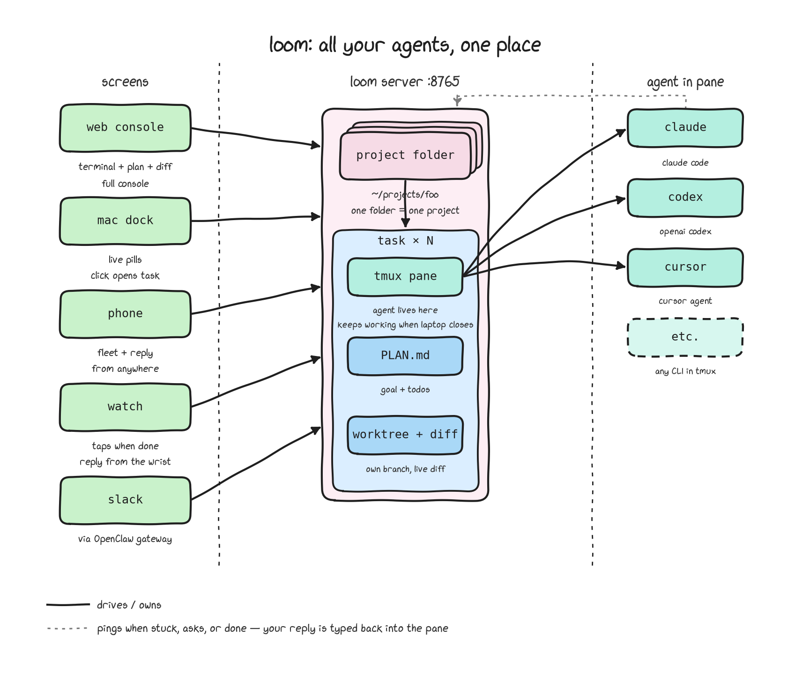
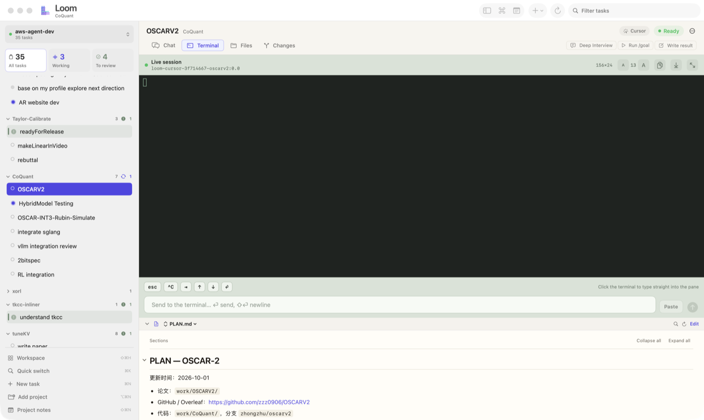
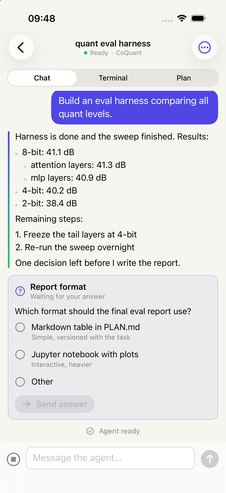
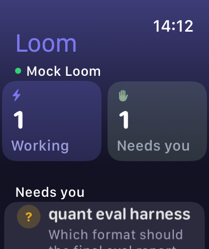

# Loom

*Stop jumping between terminals. All your agents in one place — Mac, iPhone, browser — each task on its own worktree, branch and terminal, still working after you close your laptop.*

**Loom** runs on your own server and drives Claude Code, Codex and Cursor's agent CLI. Give each task a goal: it gets a terminal, a `PLAN.md`, and an isolated worktree on its own branch — run as many in parallel as you want, then review each diff and **Merge ↩** or **Push**. Loom never commits or pushes on its own.

<!-- DEMO GIF slot: drop your gif at docs/images/demo.gif and uncomment the line below. -->
<!--  -->



## Install

> **Fastest path:** open a coding agent on the target machine and say
> *"follow [AGENT.md](AGENT.md) and deploy Loom"* — install, auth token,
> and a reachable URL, end to end.

Or do it by hand. Needs **Python 3.10+**, **git**, **tmux**, and one agent CLI
(`claude`, `codex`, or Cursor's `agent`) you have logged into.

```bash
pipx install git+https://github.com/FutureMLS-Lab/Loom.git
loom doctor        # names anything missing
```

Hacking on Loom itself: clone, `pip install -e '.[dev]'`, `pytest tests`.

## Quickstart

Installed via an agent ([AGENT.md](AGENT.md))? It already printed you a URL — open it.

```bash
loom web --projects --project ~    # → http://127.0.0.1:8765
```

Your home folder becomes the workspace: add any project under it, or create a
**New empty folder** (Loom makes it a git repo with a first commit, so its
tasks get worktrees).

Each task runs the same loop:

```
Create task ─▶ Start agent ─▶ Deep Interview ─▶ Run /goal ─▶ Write result ─▶ (repeat)
```

The interview fills `PLAN.md` (goal, an empty results table, a to-do list);
`/goal` executes it. You do not have to wait: create the next task on the
same project, and the next. The Create Task dialog shows the branch and
commit each one starts from. Three tasks in, git sees this:

```console
$ git worktree list
/home/you/app                       3f2a9c1 [main]
/home/you/app/.RUD/docs/work/app    3f2a9c1 [loom/docs]
/home/you/app/.RUD/export/work/app  3f2a9c1 [loom/export]
/home/you/app/.RUD/login/work/app   3f2a9c1 [loom/login]
```

The Changes tab shows each task's diff; **Push** or **Merge ↩** when you like
what you see, one task at a time. Loom never commits or pushes on its own:
ask the agent to commit on its branch, or commit in the Terminal tab.

To try it on a throwaway repository first, run
`scripts/make-parallel-demo.sh` from a clone of this repo. It builds a small
project and prints four tasks to paste: three merge cleanly, and one
conflicts on purpose.

## Parallel runs

Run as many tasks on one repository as you want, without collisions: every
task gets its own worktree, branch and terminal.

```
               agent   branch       worktree
           ┌─▶ Claude  loom/login   .RUD/login/work/app   ─┐
app ───────┼─▶ Codex   loom/export  .RUD/export/work/app  ─┼─▶ review the diff
your repo  └─▶ Cursor  loom/docs    .RUD/docs/work/app    ─┘          │
                                                                      ▼
                                                               Merge ↩ or Push
                                                                one at a time
```

| Isolated per task | Not isolated |
|---|---|
| Files: its own worktree, `.RUD/<slug>/work/<repo>` | GPUs, CPU, memory and ports |
| Branch: `loom/<slug>`, from your HEAD commit | Global caches and installs |
| Terminal: its own tmux session and agent | Databases and other outside services |
| Plan: its own `PLAN.md` and results table | `.env` and other untracked files: not copied in |
| Review: its own diff in the Changes tab | Lines two tasks both edit: a conflict at merge time |

The full guide (task layout, merging and conflicts, ports and GPUs, recipes):
**[docs/PARALLEL-TASKS.md](docs/PARALLEL-TASKS.md)**.

## Clients: one server, every screen

One server, same auth token — start on one screen, continue on another.

<table>
<tr>
<td align="center" valign="top" width="50%">

<br><b>Web</b> (built-in) — the full console at <code>:8765</code>
</td>
<td align="center" valign="top" width="50%">

<br><b>macOS desktop</b> — live task pills, chat, terminal and diffs (<a href="https://github.com/FutureMLS-Lab/loom-desktop">loom-desktop</a>)
</td>
</tr>
<tr>
<td align="center" valign="top" width="50%">
<!-- Phone shot: drop it at docs/images/client-phone.png and uncomment.

<br> -->
<b>Phone</b> — the fleet and agent replies in your pocket (<a href="https://github.com/FutureMLS-Lab/loom-app">loom-app</a>) · <i>screenshot coming</i>
</td>
<td align="center" valign="top" width="50%">

<br><b>Watch</b> — what needs you, on your wrist, with tap-to-reply (<a href="https://github.com/FutureMLS-Lab/loom-desktop">loom-desktop</a>)
</td>
</tr>
</table>

Making it reachable from another device: [AGENT.md](AGENT.md) step 5
(SSH tunnel / Tailscale / Cloudflare Tunnel / your own domain).

## MCP

Agents and bots get their own door: Loom's tools over **MCP** — `POST /mcp`
over HTTP, or `loom mcp` over stdio. Any MCP client can read and drive Loom
with typed tools: tasks, agent conversations, tmux sessions and keys.

```bash
export LOOM_AGENT_TOKEN=$(cat ~/.loom/agent/agent-token)  # minted when the server starts

# Claude Code
claude mcp add --scope user --transport http loom http://127.0.0.1:8765/mcp \
  --header "Authorization: Bearer $LOOM_AGENT_TOKEN"

# Codex
codex mcp add loom --url http://127.0.0.1:8765/mcp --bearer-token-env-var LOOM_AGENT_TOKEN

# Anything that launches stdio MCP servers (Claude Desktop, ...)
LOOM_URL=http://127.0.0.1:8765 LOOM_WEB_AUTH_TOKEN=... loom mcp
```

`loom agent-config` prints ready-to-paste setups for every client, including
OpenClaw and ChatGPT (OAuth, revocable token for `/mcp` only). Full tool list
and safety model: [docs/AGENT-GATEWAY.md](docs/AGENT-GATEWAY.md). To get
pinged in Slack when an agent needs you instead: [docs/OPENCLAW.md](docs/OPENCLAW.md).

## Run options

| Flag | Purpose |
|------|---------|
| `--project PATH` | Project root: a git repo, or with `--projects` a workspace folder such as `~`. |
| `--projects` | Workspace mode: `--project` is a folder of projects (such as `~`), not a project itself; add the ones you want from the console. |
| `--skills PATH` | Default skills markdown for new tasks (the default prompt is always injected regardless). |
| `--auth-token TOKEN` | Require auth (bearer / basic, password = token). Also reads `LOOM_WEB_AUTH_TOKEN`. |
| `--daemon` | Run in the background; logs in `<project>/.RUD/web.log`. |
| `--openclaw …` | Notifications + reply-back (full flags in `loom/cli.py`). |
| `~/.loom/env` | Per-host `LOOM_*` settings (default model, opt-in usage limits, …) every `loom` command loads; the real environment wins. See [docs/USAGE_BUDGETS.md](docs/USAGE_BUDGETS.md). |

## Going deeper

- **[docs/PARALLEL-TASKS.md](docs/PARALLEL-TASKS.md)** — many tasks on one
repository: what a task is on disk, merging and conflicts, what is and is
not isolated, recipes, cleanup.
- **[AGENT.md](AGENT.md)** — one-file deploy runbook an agent can execute.
- **[docs/API.md](docs/API.md)** — the HTTP API contract every client speaks
  (console, desktop, mobile, OpenClaw agents, your scripts), plus where
  everything lives on disk.
- **[docs/USAGE_BUDGETS.md](docs/USAGE_BUDGETS.md)** — opt-in context and
  turn limits (all off by default), cost-safe model defaults, AR round limits,
  and their environment overrides.
- **[docs/OPENCLAW.md](docs/OPENCLAW.md)** — notifications in Slack and
replying to agents from there.
- **[docs/AGENT-GATEWAY.md](docs/AGENT-GATEWAY.md)** — Loom over MCP: how
agents and bots query and drive Loom, the tool list, and the safety model.
- **[docs/LOOM_CODEBASE_ARCHITECTURE.md](docs/LOOM_CODEBASE_ARCHITECTURE.md)**
and **[docs/FIGURE_SKILL_FLOW.md](docs/FIGURE_SKILL_FLOW.md)** — how the
codebase and the figure-skill pipeline are put together.

## Licence

Noncommercial use only, under the
[PolyForm Noncommercial 1.0.0](https://polyformproject.org/licenses/noncommercial/1.0.0)
terms in `[LICENSE](LICENSE)`. Commercial use needs a separate licence from
FutureMLS-Lab.